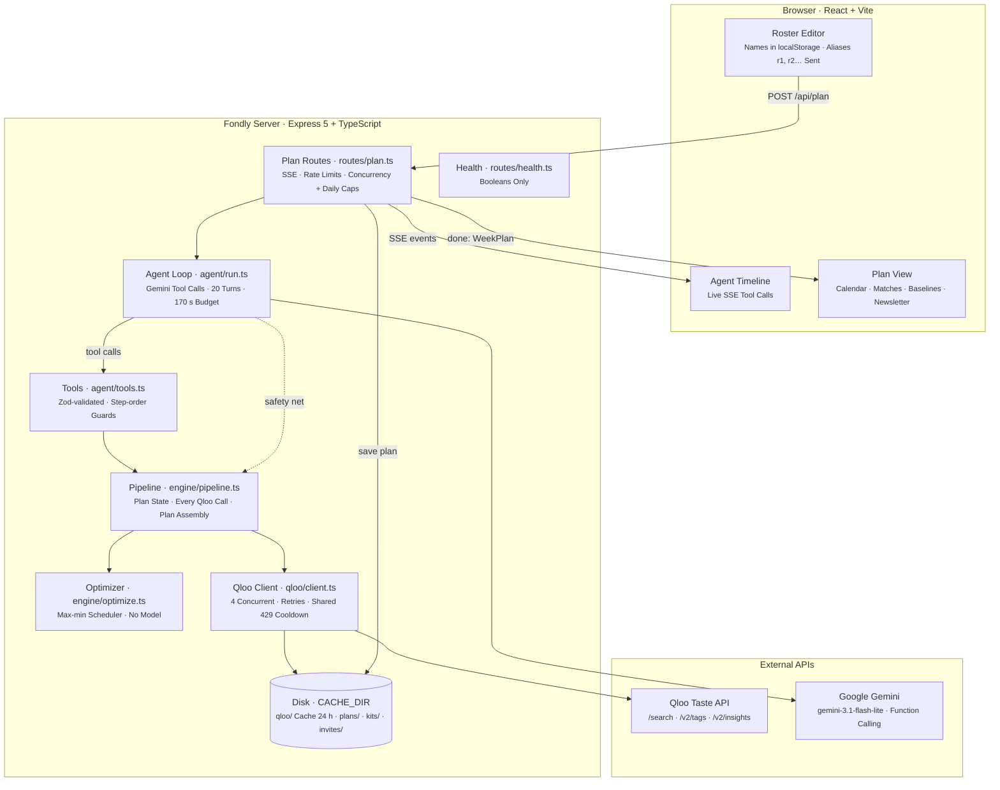
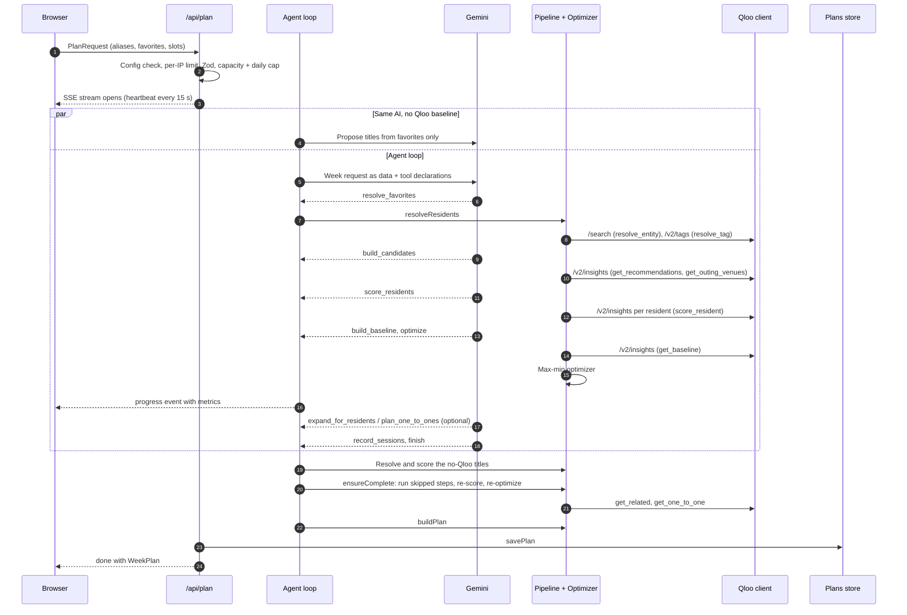
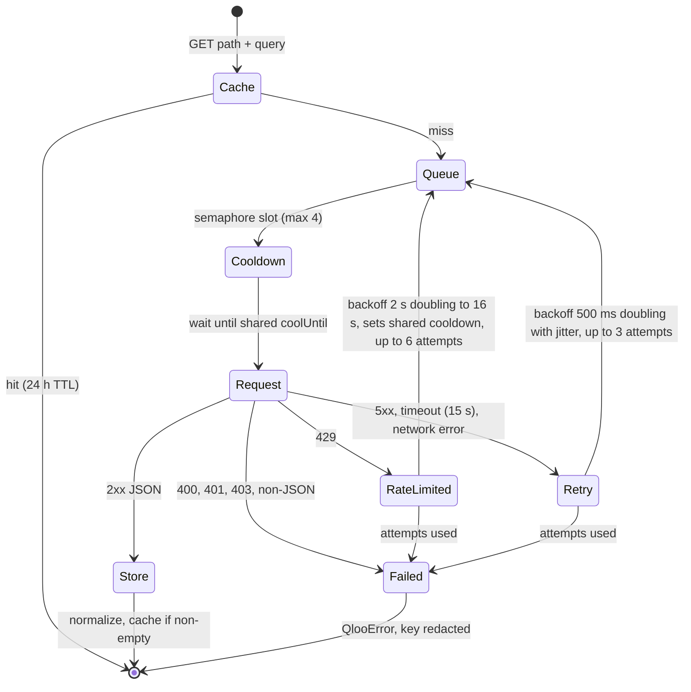
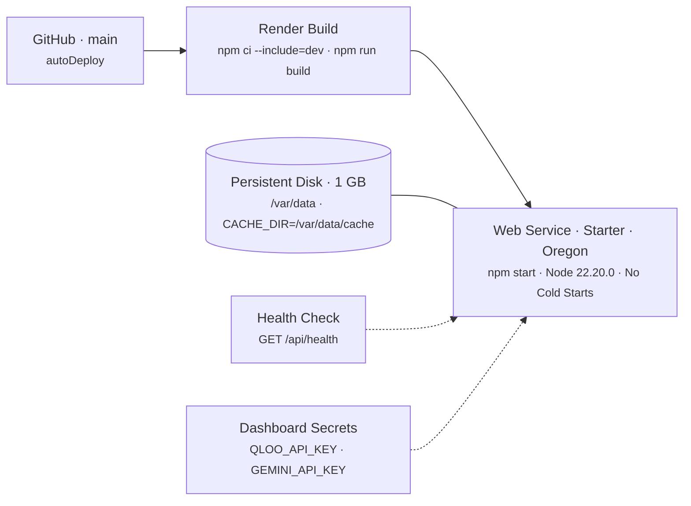

# Fondly architecture

Fondly plans a week of group activities for a care home around one rule: the language model can choose steps and write prose, but every fit, every metric and every scheduled item comes from Qloo data and deterministic code.

## System architecture

One Node process serves both the API and, in production, the built UI from `dist/web` with an SPA fallback. Unknown `/api` routes always return a JSON 404, never the SPA.

The model never sees full Qloo entities. Tools return compact JSON keyed by resident aliases, while entities stay in `PipelineState`. So a plan can only contain items Qloo actually returned.

## Components

| Component | File | Responsibility |
| --- | --- | --- |
| App | `server/app.ts`, `server/index.ts` | Security headers, JSON body limit, routers, static hosting, error handler; lazy Qloo and Gemini clients so the server boots without keys |
| Config | `server/config.ts` | Zod-validated env; reports invalid or missing variable names, never values |
| Plan routes | `server/routes/plan.ts` | `POST /api/plan`, `POST /api/plans/:id/replan`, `POST /api/intake`, `GET /api/plans/:id`; SSE streaming, limits, user-safe errors, plan diffs |
| Agent loop | `server/agent/run.ts` | Gemini function-calling loop, the "same AI, no Qloo" baseline in parallel, `ensureComplete` safety net |
| Tools | `server/agent/tools.ts` | Tool schemas and handlers wrapping the pipeline |
| Gemini helpers | `server/agent/gemini.ts`, `server/agent/structured.ts` | Retries on 429/5xx, JSON-schema output, intake notes to favorites, re-plan instructions to edits |
| Pipeline | `server/engine/pipeline.ts` | Resolve favorites, candidates, scoring, baselines, related titles, 1:1 visits, plan assembly |
| Qloo ops | `server/engine/qloo-ops.ts` | Request builders per session type, name matching, group-suitability filters |
| Optimizer | `server/engine/optimize.ts` | Greedy construction plus local search over reach, least-served fit and mean fits |
| Tracer | `server/engine/trace.ts` | Wraps code-driven Qloo calls in `tool_call`/`tool_result` events, records the first auth or quota failure, bounded `mapLimit` |
| Qloo client | `server/qloo/client.ts`, `server/qloo/params.ts`, `server/qloo/cache.ts` | Live HTTP client, param validation, response normalizers, disk cache |
| Plans store | `server/plans-store.ts` | One JSON file per plan, atomic writes, retention; shared `atomicWriteJson` and `pruneJsonDir` helpers |
| Session kits | `server/routes/kits.ts`, `server/kits/generate.ts`, `server/kits/store.ts` | Kit route and limits, Gemini kit writer with template fallback, per-plan kit cache |
| Family taste link | `server/routes/family.ts`, `server/invites-store.ts` | Invite and family endpoints, Qloo autocomplete, limits; hashed-token invite store with expiry and retention |
| Web | `web/src/` | Roster editor and storage (`roster.ts`), roster backup (`roster-backup.ts`, `RosterBackup.tsx`), SSE client (`api.ts`), agent timeline, plan view, family links (`family.ts`, `FamilyLinkPanel.tsx`) and family page (`FamilyPage.tsx`) |

## Plan flow

Every tool call and every code-driven Qloo request reaches the browser as a `tool_call`/`tool_result` pair, so the timeline shows the real work. The route emits `done` or `error` itself; the agent only emits `status`, `tool_call`, `tool_result` and `progress`.

### Agent and tools

| Tool | What it does | Requires |
| --- | --- | --- |
| `resolve_favorites` | Match favorites to Qloo entities (`/search`) and food to tags (`/v2/tags`) | |
| `build_candidates` | Group candidate pool per session type from `/v2/insights` | `resolve_favorites` |
| `score_residents` | Per-resident affinity for every unscored candidate | `build_candidates` |
| `build_baseline` | Qloo "most popular titles" calendar (popularity ≥ 0.5, age 55+ hint) | `resolve_favorites` |
| `optimize` | Re-score missing pairs, run the scheduler, return metrics and unreached residents | `score_residents` |
| `expand_for_residents` | Extra candidates aimed at specific residents' taste | `optimize` |
| `plan_one_to_ones` | 1:1 visit plans for residents still unreached | `optimize` |
| `record_sessions` | Title and staff brief per scheduled slot; rejects unknown slots | `optimize` |
| `finish` | Staff summary and family newsletter | `optimize` |

Tools run in the order the model issued them, since they share state. Inputs are validated with Zod; a bad input or an out-of-order call returns an error to the model instead of throwing.

The loop stops at `finish`, after 20 turns, or when less than 15 seconds of the 170-second budget remain. If Gemini errors (other than a rejected key), declines a step, or stops early, the run continues: `ensureComplete` runs any skipped step, always re-scores and re-optimizes, fetches related titles and plans 1:1 visits. If the final numbers moved after the agent wrote its summary, the summary is dropped, and titles or briefs written for a slot whose pick changed fall back to templates. A title is also replaced if it doesn't name the scheduled item (`namesEntity`).

### Optimizer

`optimize()` assigns one candidate per slot, each candidate at most once per week. The objective is lexicographic: residents reached (best fit ≥ `REACH_THRESHOLD`, 0.8), then the least-served resident's best fit, then the mean of each resident's top two fits, then the mean best fit. It fills the slots with the fewest options first, then improves by single-slot replacement and pairwise swaps until no move helps. Locked slots (edit mode) never change; excluded candidates (next week) are never used. A resident's own favorite counts as a perfect fit for them; declined items count as zero.

### Baselines

Both comparison calendars fill the same slots and are scored with the same Qloo fits and the same metric:

- **Generic "most popular titles".** Qloo insights with a popularity floor and an older-adult age signal, no resident data.
- **Same AI, no Qloo.** Gemini proposes titles from the residents' favorites without Qloo. Titles are resolved through Qloo search only so they can be scored. Outing slots are skipped. This runs in parallel with the agent; if it fails, the plan notes it.

### Re-planning

`POST /api/plans/:id/replan` loads the saved plan and streams a new one with `previousPlanId` and a `diff` (changed slots, residents whose reach or best fit moved, and an edit log).

- **Reactions.** Loved and declined marks become each resident's `loved` and `declined` lists.
- **`next_week`.** Every entity from the previous week is excluded.
- **`edit`.** An optional free-text instruction is parsed by Gemini into edits that code validates and applies. Sessions stay locked if their slot is unchanged and they still strongly match at least two residents who can attend and haven't declined them.

`POST /api/intake` turns free-text notes into suggested favorites. The browser strips resident names from notes before sending them.

## Qloo client

| Behavior | Detail |
| --- | --- |
| Concurrency | A semaphore allows 4 in-flight Qloo requests per client. The pipeline also batches with `mapLimit(…, 4)`. |
| Retries | 429, 5xx, timeouts and network errors retry. 400, 401, 403 and non-JSON responses fail at once with a specific message. |
| `Retry-After` | Honored as seconds or a date, capped at 10 seconds. |
| Shared 429 cooldown | The hackathon API sends no `Retry-After`. On a 429 the client backs off 2 s, 4 s, 8 s, 16 s (cap) plus up to 25% jitter, and sets `coolUntil` so every queued call waits instead of re-bursting. Rate limits get 6 attempts instead of 3. |
| Cache | Normalized results are stored as one JSON file per SHA-256 of the request under `<CACHE_DIR>/qloo/`, for 24 hours. Empty results are not cached. Cache read or write failures never break a request. |
| Redaction | Every `QlooError` message has the API key replaced with `[REDACTED]`. The key is sent only in the `X-Api-Key` header. |
| Normalizers | Responses are normalized defensively (malformed items skipped, HTML entities decoded once). |

The tracer logs swallowed Qloo failures with status and a clipped, already-redacted message. The first 401, 403 or 429 is kept as `tracer.fatal`, so a run with no candidates reports the real cause.

## Plan persistence

Finished plans are saved by `server/plans-store.ts` as `<CACHE_DIR>/plans/<uuid>.json`. Writes go to a temp file and are renamed into place. Plan ids must be UUIDs, checked before any file path is built. After a save, at most every 10 minutes, plans older than 90 days or beyond the newest 5,000 are pruned. Saved plans hold aliases and public favorites, never names. Entities are slimmed to 8 tags to keep files small.

Everything under `CACHE_DIR` is bounded, and pruning runs on writes:

| Folder | Retention |
| --- | --- |
| `qloo/` | 1-day TTL. At most hourly after a cache write, files older than the TTL are deleted and only the newest 2,000 kept. |
| `plans/` | 90 days, newest 5,000, at most every 10 minutes after a save. |
| `kits/<planId>/` | 90 days. Stale kits are ignored on read; at most hourly after a save, per-plan folders untouched past the window are removed. |
| `invites/` | Links expire after 14 days. Files untouched for 30 days are deleted and only the newest 5,000 kept, at most every 10 minutes after an invite is created. Reviewed invites keep no answers. |

## Session kits and exports

`POST /api/plans/:id/sessions/:sid/kit` (`server/routes/kits.ts`) builds a kit for one session of a saved plan. Facts and media links come from the Qloo entity in code (`shared/kit.ts`): name, year, description, tags, image, and search URLs (YouTube and Spotify for music, YouTube trailer for film/TV, Open Library for books, Google Maps for outings with an address). Gemini (`server/kits/generate.ts`) writes the read-aloud intro, 5 prompts, adaptation tips and a 3-question quiz as Zod-validated structured output, grounded on those facts only. Output that adds years not in the facts, medical terms or resident details is rejected. On failure a deterministic template kit is returned, marked `source: "template"`, and not cached so a later open can retry. Gemini kits are stored as `<CACHE_DIR>/kits/<planId>/<sid>.json` (`server/kits/store.ts`) and returned with `cached: true` on later calls. Kit generation has its own hourly per-IP limit and daily cap; cache hits still pass a looser per-IP request limit.

The `.ics` file (`shared/ics.ts`) and noticeboard poster are built in the browser. The calendar has one VEVENT per session with a stable UID, RFC 5545 escaping, CRLF line endings and folding at 75 octets. Plans store only a weekday and part of day, so events land on the upcoming Monday-to-Sunday (the next Monday after today, local time) at the slot times, as floating local times with no time zone. The poster shows day, time, title and a short line, with no resident names or fits.

## Family taste link

A coordinator can ask relatives for a resident's favorites without sharing the resident's name.

1. **Create.** `POST /api/invites` with the resident alias returns two 192-bit secrets: a `token` for the family and a `manageKey` for the coordinator. The browser keeps both in localStorage (`fondly.familyLinks.v1`, scoped to the roster id) and builds the link `/#/family/<token>?for=<label>`. The optional label (for example "Mum") lives only in the `#fragment`, which browsers never send.
2. **Family answers.** The link opens a separate minimal page (`FamilyPage.tsx`) that never touches the roster. It reads the invite with `GET /api/family` and saves with `PUT /api/family`, with the token in the `X-Family-Token` header. Autocomplete (`GET /api/family/search`) uses Qloo `/search` for entities and `/v2/tags` for food, and works only for live, unreviewed invites so it is not an open Qloo proxy. A submission holds up to 30 favorites and 15 things to avoid; avoided items must be picked Qloo entities and cannot be food. There are no free-text notes. Families can edit their answers until the coordinator reviews them.
3. **Review.** The coordinator's browser polls `POST /api/invites/status` (token and manage key per invite) every minute. "Review & add" lets them choose which suggestions to keep: `mergeFamilyItems` adds favorites up to 20 per resident and turns avoided items into `declined` Qloo ids, so the optimizer never matches them. `POST /api/invites/review` marks the invite reviewed, deletes the family's answers from the server and closes the link.

Invites are stored as `<CACHE_DIR>/invites/<sha256(token)>.json`, so a directory listing never reveals live tokens, and only a SHA-256 of the manage key is kept (compared in constant time). A wrong manage key reads as not found. Writes to one invite are serialized with a lock. Links expire after 14 days. Secrets travel in headers or JSON bodies, never URL paths, so request logs never contain them; responses are `Cache-Control: no-store`, and family endpoints have a 16 KB JSON body limit.

## Roster backup

The roster lives only in the browser, so the roster editor can export it and import it again (`web/src/roster-backup.ts`; UI in `RosterBackup.tsx`). Nothing is sent to the server.

- **JSON** is a full backup: `{ format: "fondly-roster", version: 1, roster: { homeName, homeCity, residents, slots } }`. Resident objects are written whole, so fields added later round-trip.
- **CSV** holds residents only: `id`, `name`, one column per favorite kind, then the unavailable days and times, opt-outs, loved and declined lists. List items are separated by `;` (a literal `;` or `\` is escaped with `\`). Unknown resident fields become extra columns; on import, unknown columns are kept as resident fields and missing columns get defaults. Cells that would start a spreadsheet formula are prefixed with `'` and restored on import.
- **Import** validates with Zod using the plan request's bounds (60 residents, 20 favorites each, id-safe Qloo ids, unique ids, one session per day and time) and reports the first problem with its row or resident number. If a roster already exists, the coordinator chooses **replace** (keeps the roster id and plan history; family links whose alias now belongs to someone else are dropped) or **merge by name** (a case-insensitive name match updates that resident and keeps their alias; new names get new aliases).

## Access and limits

The public demo has no authentication, so judges can use it without logging in. Abuse is bounded by limits in `server/routes/plan.ts`, `server/routes/kits.ts` and `server/routes/family.ts`:

| Endpoint | Limit |
| --- | --- |
| `POST /api/plan`, `POST /api/plans/:id/replan` | `PUBLIC_RATE_LIMIT_PER_HOUR` per IP (20), 3 concurrent runs, `DAILY_PLAN_CAP` per UTC day (200) |
| `POST /api/intake` | 5× the hourly plan limit per IP, 10× the daily cap |
| `GET /api/plans/:id` | max(120, 30× the hourly plan limit) per IP |
| Planning endpoints without keys | `503`, with only the missing variable names logged server-side |
| `POST /api/plans/:id/sessions/:sid/kit` | Gemini generations at 3× the hourly plan limit per IP and 21× the daily plan cap; cache hits use a looser per-IP limit |
| `POST /api/invites` | 60 per IP per hour, 2,000 per UTC day across all users |
| `GET /api/family`, `POST /api/invites/status` | 600 per IP per hour |
| `PUT /api/family`, `POST /api/invites/review` | 30 per IP per hour |
| `GET /api/family/search` | 400 per IP per hour, 5,000 Qloo searches per UTC day |

`trust proxy` is set to one hop for Render. Limits and caps are in memory per process.

## Security

- **Secrets.** `QLOO_API_KEY` and `GEMINI_API_KEY` come from the environment only (`.env` locally, Render env vars with `sync: false`). `/api/health` reports booleans and the model name. Config errors name variables, never values.
- **Errors.** `friendlyError` maps Qloo, Gemini and agent errors to fixed user messages. The final error handler returns `Internal error` with no stack. Request logs record method, path, status and time only, with no query strings or bodies.
- **Input.** 256 KB JSON limit. Zod schemas bound every request field (at most 60 residents, 20 favorites each, 21 slots) and every tool input. Entity ids are restricted to id-safe characters because they are joined into Qloo params.
- **Prompt input.** The week request goes to Gemini wrapped in `<week_request>` tags as data. The model sees only aliases and counts.
- **Headers.** CSP with `script-src 'self'` and `connect-src 'self'`, `frame-ancestors 'none'`, `X-Frame-Options: DENY`, `nosniff`, strict referrer policy.

## Configuration

| Variable | Purpose | Default |
| --- | --- | --- |
| `QLOO_API_KEY` | Qloo key (required to plan) | none |
| `QLOO_BASE_URL` | Qloo host | `https://hackathon.api.qloo.com` |
| `GEMINI_API_KEY` | Gemini key (required to plan) | none |
| `GEMINI_MODEL` | Model id | `gemini-3.1-flash-lite` |
| `GEMINI_THINKING` | `minimal`, `low`, `medium` or `high` | `low` |
| `GEMINI_FALLBACK_MODELS` | Comma-separated models tried in order when the primary returns 5xx or 404; `none` disables | `gemini-3.5-flash,gemini-3-flash-preview` |
| `CACHE_DIR` | Qloo cache, saved plans, session kits, family invites | `.cache` |
| `PUBLIC_RATE_LIMIT_PER_HOUR` | Plans per IP per hour | `20` |
| `DAILY_PLAN_CAP` | Plans per day, all users | `200` |
| `PORT` | HTTP port | `3000` |

Names and defaults are in `.env.example` and `server/config.ts` (the `GEMINI_*` model settings are read in `server/agent/gemini.ts`).

## Deployment

`render.yaml` defines one web service. Dev dependencies are installed because `NODE_ENV=production` would otherwise skip Vite and `tsx`, which the build and start commands need. The disk keeps the Qloo cache, saved plans, session kits and invites across deploys; each folder prunes itself (see Plan persistence). On `SIGTERM` the server stops accepting connections and force-exits after 10 seconds, since SSE streams can hold connections open.

## Testing

| Command | What it runs |
| --- | --- |
| `npm run typecheck` | `tsc -p tsconfig.json` over `shared`, `server`, `web/src` and `scripts` |
| `npm run smoke [city]` | `scripts/smoke-qloo.ts`: every Qloo call Fondly makes, against the live API; prints pass or fail and entity names, never the key |

## Limitations

- No authentication. Saved plans are readable by anyone with the UUID; they hold no names.
- Single instance. Rate limits, the concurrency cap and the daily caps are in memory and reset on restart. Cache, plans, kits and invites live on one disk.
- The roster, family link secrets and the plan-to-name mapping live in one browser. Export a roster backup before clearing it; family links are not part of the backup.
- Plan quality depends on how well favorites resolve on Qloo. Residents with no resolvable favorites can't be scored and are listed with warnings.
